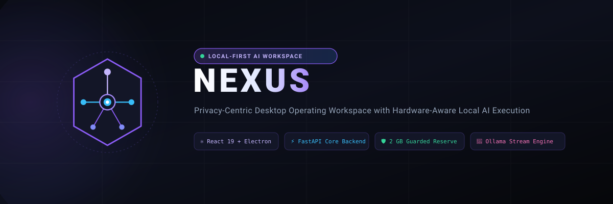
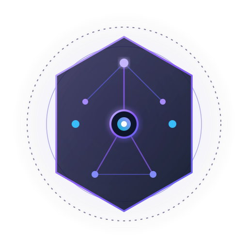

<div align="center">



<br/><br/>



# NEXUS

**Local-First AI Desktop Workspace with Real-Time Hardware Resource Guardrails**

[-blue.svg)](#license)
[](https://www.python.org/)
[](https://fastapi.tiangolo.com/)
[](https://www.electronjs.org/)
[](https://react.dev/)
[](docs/TESTING.md)

</div>

---

## Overview

**NEXUS** is an intelligent, privacy-preserving desktop workspace designed to run small language models locally while actively protecting host hardware responsiveness. 

Unlike traditional wrappers that run models uncapped and trigger system freezes or memory thrashing, NEXUS treats local resources (RAM and CPU) as finite, managed assets. Through a two-tier admission control engine, NEXUS continuously samples host telemetry, tracks running development workloads, and ensures the machine never crosses critical thermal or memory saturation thresholds.

NEXUS combines a full-sized **Workspace Window**, a persistent **Floating Companion Widget**, a local **FastAPI service**, and local **Ollama inference** (`gemma3:1b`) with real-time Server-Sent Events (SSE) token streaming.

---

## Key Pillars & Engineering Guarantees

- **Hardware Safety Floor**: Strictly enforces a minimum $2.0\text{ GB}$ free RAM reserve and $80\%$ maximum CPU ceiling before admitting any inference task. User settings can raise safety thresholds, but cannot weaken them.
- **Strict Process Isolation**: Only manages child processes spawned directly by NEXUS. Existing background services (such as independent Ollama daemons) are never terminated or sent unload signals.
- **Zero Cloud Leakage**: All computation, inference, and telemetry remain strictly bound to the local loopback interface (`127.0.0.1`).
- **Antigravity Workload Priority**: Continuously monitors for active IDE and developer processes, dynamically deprioritizing or deferring background AI tasks when development activity spikes.
- **Real-Time Token Streaming**: Streams tokens from local models over SSE with progressive frontend Markdown rendering.

---

## System Architecture

NEXUS employs a modular multi-tier desktop architecture:

```
┌────────────────────────────────────────────────────────┐
│                   NEXUS Desktop Shell                  │
│               (Electron Main Process)                  │
│    ┌─────────────────────────┐  ┌────────────────────┐ │
│    │     Main Workspace      │  │ Floating Companion │ │
│    │     (React / Vite)      │  │   (Quick Prompt)   │ │
│    └────────────┬────────────┘  └─────────┬──────────┘ │
└─────────────────┼─────────────────────────┼────────────┘
                  │   IPC / HTTP (127.0.0.1)│
┌─────────────────▼─────────────────────────▼────────────┐
│                    FastAPI Backend                     │
│                (App Service on :8000)                  │
│  ┌──────────────────────┐    ┌──────────────────────┐  │
│  │   Resource Manager   │    │  Ollama AI Provider  │  │
│  │ (Telemetry & Limits) │    │(Discovery & Streaming│  │
│  └──────────┬───────────┘    └──────────┬───────────┘  │
└─────────────┼───────────────────────────┼──────────────┘
              │ Win32 API                 │ HTTP / SSE
┌─────────────▼───────────┐    ┌──────────▼──────────────┐
│  Host Operating System  │    │     Ollama Runtime      │
│  (CPU & RAM Telemetry)  │    │   (127.0.0.1:11434)     │
└─────────────────────────┘    └─────────────────────────┘
```

Detailed architectural blueprints, lifecycle diagrams, and IPC communication protocols are documented in [`docs/ARCHITECTURE.md`](docs/ARCHITECTURE.md).

---

## Verified Hardware Benchmarks

All benchmarks were captured on an ultrabook-tier reference machine (**Intel Core i3-1215U, 16 GB DDR4 RAM, Intel UHD Graphics, Windows 11**) to validate performance under genuine hardware constraints.

| Model | Parameter Size | Disk Footprint | Peak RAM During Inference | Inference Speed | System Stability |
| :--- | :--- | :--- | :--- | :--- | :--- |
| **Gemma 3:1B** *(Active)* | $1.0\text{ B}$ | $815\text{ MB}$ | $1.85\text{ GB}$ | $16.8\text{ tokens/sec}$ | **Rock Solid** ($<45\%$ CPU) |
| **Qwen 2.5 Coder 1.5B** | $1.5\text{ B}$ | $986\text{ MB}$ | $2.10\text{ GB}$ | $14.2\text{ tokens/sec}$ | **Stable** ($<55\%$ CPU) |
| **Phi-4-mini** *(Restricted)* | $3.8\text{ B}$ | $2.49\text{ GB}$ | $4.80\text{ GB}$ | $6.1\text{ tokens/sec}$ | **Heavy** (High thermal load) |
| **Nomic Embed Text** | $137\text{ M}$ | $274\text{ MB}$ | $0.65\text{ GB}$ | Fast Batch | **Negligible Impact** |

For complete methodology, concurrent benchmark data, and thermal recovery profiles, see [`docs/MODEL_BENCHMARKS.md`](docs/MODEL_BENCHMARKS.md) and [`benchmarks/`](benchmarks/).

---

## Project Structure

```
nexus/
├── assets/                  # Branding assets (banner, logo, favicon)
├── backend/                 # Python 3.11+ FastAPI service
│   ├── app/
│   │   ├── api/             # API routes (ai_provider, resources)
│   │   ├── core/            # Database and core config
│   │   ├── db/              # SQLite schema & persistence
│   │   └── services/        # AI providers, Resource Manager, Process Manager
│   └── tests/               # 42 automated unit and integration tests
├── desktop/                 # Electron main process & IPC handlers
├── frontend/                # React 18 + Vite + TypeScript interface
├── docs/                    # Technical architecture & specification documents
├── benchmarks/              # Empirical hardware benchmarking logs & methodology
├── ROADMAP.md               # Feature classification & implementation status
├── CHANGELOG.md             # Version history & phase milestones
├── CONTRIBUTING.md          # Development setup & contribution guidelines
└── SECURITY.md              # Security model & vulnerability reporting
```

---

## Quickstart Guide

### Prerequisites
- Python 3.11 or newer
- Node.js 18+ and npm
- [Ollama](https://ollama.ai) installed and running locally with Gemma 3:1B:
  ```bash
  ollama pull gemma3:1b
  ```

### 1. Backend Setup
```bash
cd backend
python -m venv .venv
# Windows PowerShell:
.venv\Scripts\Activate.ps1
# Linux / macOS:
# source .venv/bin/activate
pip install -r requirements.txt
```

Run the backend manually:
```bash
uvicorn app.main:app --host 127.0.0.1 --port 8000
```

### 2. Frontend & Desktop Setup
```bash
# Install frontend dependencies
cd frontend
npm install

# Install desktop dependencies
cd ../desktop
npm install

# Start development workspace
npm run dev
```

---

## Running Test Suites

NEXUS maintains a strict 100% pass rate on all automated tests:

```bash
# Backend unit and integration tests (42 tests)
python -m unittest discover -s backend/tests -p "test_*.py"

# Frontend production build verification
npm --prefix frontend run build

# Electron TypeScript build verification
npm --prefix desktop run build
```

---

## Implementation Status

| Milestone | Scope | Status |
| :--- | :--- | :--- |
| **Phase 1.0 - 1.7** | Electron shell, dual-window lifecycle, safe close, resource manager baseline, process ownership separation | **COMPLETED & VERIFIED** |
| **Phase 2.1 - 2.2** | Ollama preflight audit, provider abstraction, non-invasive model discovery | **COMPLETED & VERIFIED** |
| **Phase 2.3** | Gemma 3:1B live inference, SSE streaming API, React streaming UI | **COMPLETED & VERIFIED** |
| **Phase 2.4** | On-demand coding assistant role switching (`qwen2.5-coder:1.5b`) | *PLANNED* |
| **Phase 2.5** | High-consumption model confirmation modal (`phi4-mini`) | *PLANNED* |
| **Phase 2.6** | On-demand vector memory embeddings (`nomic-embed-text`) | *PLANNED* |

See [`ROADMAP.md`](ROADMAP.md) for detailed feature classification and future milestones.

---

## Documentation Index

- [Architecture & IPC Blueprint](docs/ARCHITECTURE.md)
- [Resource Management & Telemetry](docs/RESOURCE_MANAGEMENT.md)
- [Model Benchmark Data & Concurrency](docs/MODEL_BENCHMARKS.md)
- [Target Hardware Constraints Profile](docs/HARDWARE_PROFILE.md)
- [Development History & Phase Commits](docs/DEVELOPMENT_HISTORY.md)
- [Local Security & Privacy Design](docs/SECURITY_DESIGN.md)
- [FastAPI Endpoint Reference](docs/API_REFERENCE.md)
- [Test Suite Breakdown & Coverage](docs/TESTING.md)
- [Known Hardware & Software Limitations](docs/KNOWN_LIMITATIONS.md)
- [Future Engineering Milestones](docs/FUTURE_IMPROVEMENTS.md)

---

## License

This project is currently evaluating between the **MIT License** and **Apache License 2.0**. See the final project transformation report for the licensing recommendation.
