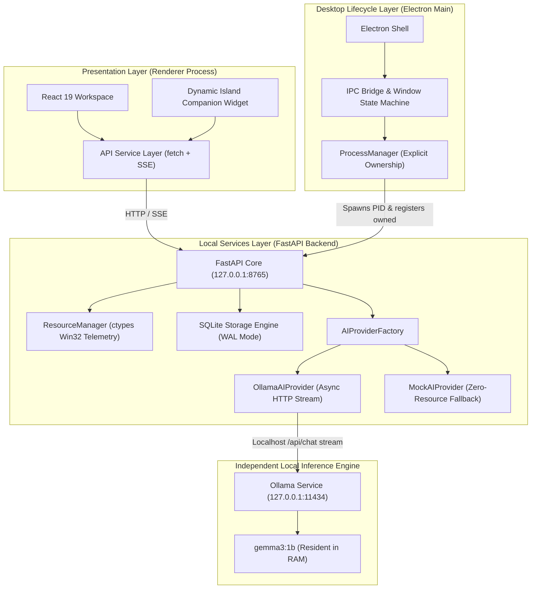

# NEXUS System Architecture

## 1. Architectural Overview

NEXUS is designed as a local-first personal AI desktop workspace. Its architectural foundation isolates user interactions, local execution engines, and background tasks through a modular three-tier structure:

---

## 2. Core Architectural Principles

1. **Local-First and Zero Cloud Dependency:**
   All token generation, embedding extraction, and persistence operate exclusively on `127.0.0.1`. No outbound network telemetry or remote API keys are utilized.
2. **Strict Process Ownership Isolation:**
   The desktop runtime maintains an explicit registry (`ownedPids: Set<number>`). Only child processes explicitly spawned by NEXUS (the FastAPI backend) are eligible for termination. Independently running services (such as Ollama) are never terminated on application exit.
3. **Hard Resource Admission Boundaries:**
   To guarantee that the host operating system and development tools (e.g., Google Antigravity) retain priority, inference requests must pass admission checks:
   - Maximum system CPU utilization threshold: $\le 80.0\%$
   - Minimum available RAM reserve: $\ge 2.0\text{ GB}$
   User settings may tighten these limits (e.g., $70\%$ CPU or $2.5\text{ GB}$ RAM), but can never weaken them.
4. **Transparent Model Ownership:**
   Before executing inference, NEXUS inspects Ollama's resident model list (`/api/ps`). Models pre-existing in memory are classified as `external_unowned` and will never be unloaded by NEXUS. Models loaded through NEXUS are tracked as `nexus_managed` and safely unloaded via `keep_alive: 0` when cleaning up.
5. **Decoupled Fallback:**
   If the local Ollama daemon is offline or unreachable, `AIProviderFactory` switches to `MockAIProvider` with an explicit indicator in both the API and user interface.

---

## 3. Component Breakdown

### 3.1 Presentation Layer (`frontend/`)
- Built with React 19, TypeScript, Vite, and Tailwind CSS.
- **`ConversationWorkspace.tsx`:** Primary conversational view supporting progressive SSE token streaming, inline speed telemetry, and an interactive Stop Generation control wired to an `AbortController`.
- **`DynamicIsland.tsx`:** A compact companion interface displaying real-time CPU utilization and active task state.
- **`SettingsView.tsx`:** System threshold configuration panel exposing resource boundary controls and hardware telemetry.

### 3.2 Desktop Lifecycle Layer (`desktop/`)
- Electron container managing native window state and child process management.
- **`main.ts`:** Implements window close interception: clicking the window close button hides the main window into the companion rather than terminating it, avoiding recursive close loops through an explicit `isExplicitQuitting` state machine.
- **`processManager.ts`:** Manages the lifecycle of the FastAPI backend. Strictly isolates owned PIDs to protect external developer processes.

### 3.3 Core Backend Services (`backend/app/`)
- **`api/ai_provider.py`:** Exposes `/api/ai/status`, `/api/ai/models`, `/api/ai/chat`, and `/api/ai/stream`.
- **`services/resource_mgr.py`:** Low-frequency (5s) system telemetry sampler using Windows Win32 API calls (`GlobalMemoryStatusEx` and `GetSystemTimes`).
- **`services/ai/ollama.py`:** Implements asynchronous token streaming via `httpx.AsyncClient` connected to Ollama's `/api/chat`.
- **`services/ai/factory.py`:** Dynamic provider resolution with visible fallback notifications.
- **`db/database.py`:** SQLite database utilizing WAL mode and transactional system settings persistence.
