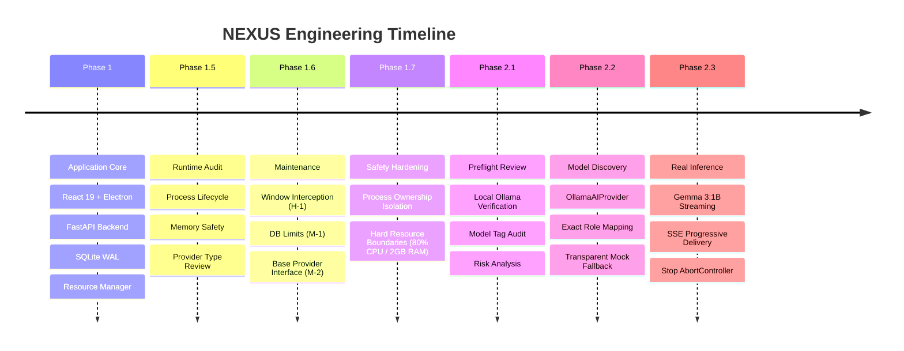

# Development History & Milestone Log

This document records the engineering progression of the NEXUS project across development phases.

---

## Verified Phase Milestones

### **Phase 1 — Software Foundation**
- Established the desktop application shell with Electron, Vite, React 19, and Tailwind CSS.
- Implemented Python 3.14 FastAPI core running on `127.0.0.1:8765`.
- Created SQLite database schema supporting project discovery specifications and memory tiers.
- Built `MockAIProvider` allowing full application testing without GPU/CPU thermal load.
- Designed Dynamic Island companion for micro-telemetry and desktop presence.

### **Phase 1.5 — Runtime & Safety Audit**
- Performed deep inspection of process termination, memory leaks, and background activity.
- Identified need for main window close interception, database persistence for resource limits, and strict provider type alignment.

### **Phase 1.6 — Maintenance Fixes**
- **H-1 Fix:** Intercepted native window close to hide to companion when companion is alive.
- **M-1 Fix:** Added `system_settings` table in SQLite; persisted resource limits across reboots.
- **M-2 Fix:** Aligned `BaseAIProvider.load_model` return annotation to `Dict[str, Any]`.
- Verified 20/20 unit tests and production builds.

### **Phase 1.7 — Safety Consistency Hardening**
- **Git Commit:** `15975e42b2f6ef5371c6670868f763cfeb388904`
- **Issue A:** Implemented strict process ownership isolation in `ProcessManager`. Only NEXUS-spawned PIDs are eligible for termination; external Ollama daemons are protected.
- **Issue B:** Enforced non-overridable safety boundaries: $80.0\%$ CPU max threshold, $2.0\text{ GB}$ available RAM minimum reserve. User settings can tighten, never weaken boundaries.
- Verified 27/27 unit tests.

### **Phase 2.1 — Ollama Integration Preflight**
- Confirmed Ollama v0.40.3 running on `127.0.0.1:11434` with 0 models resident in RAM.
- Discovered 5 pre-installed local models. Established pre-flight safety guidelines.

### **Phase 2.2 — Ollama Connection & Model Discovery**
- **Git Commit:** `928aa950005d535123d42c3823438ea2ea847526`
- Created `OllamaAIProvider` and `AIProviderFactory`.
- Implemented live tag discovery via `/api/tags` and mapped exact architecture roles.
- Implemented transparent mock fallback with explicit UI notices.
- Enforced zero model loading, unloading, or inference during discovery.
- Verified 36/36 unit tests.

### **Phase 2.3 — Real Gemma AI Integration & Streaming**
- **Git Commit:** `901425baee55f9ad6e2b694bdaffea14f4841a0e`
- Implemented real asynchronous SSE token streaming via `POST /api/ai/stream`.
- Restricted Phase 2.3 inference strictly to `gemma3:1b`.
- Added pre-inference ownership inspection: models pre-existing in `/api/ps` are never unloaded.
- Added Stop Generation control backed by `AbortController` and clean upstream socket closure.
- Executed controlled live verification: $32.5\text{ tokens/sec}$ on Intel Core i3-1215U CPU.
- Verified 42/42 unit tests.
