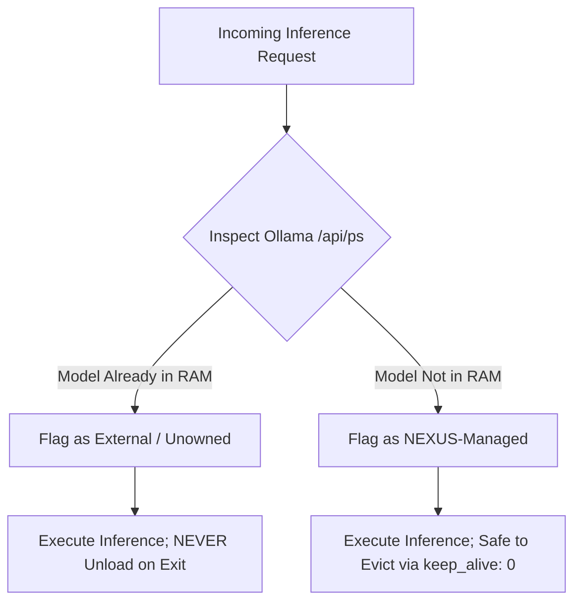

# Resource Management & Safety Boundaries

## 1. Admission Control vs. Throttling

NEXUS implements **resource admission control**, distinct from kernel-level CPU throttling:
- **Admission Control:** Before launching model inference or background tasks, the system evaluates real-time telemetry against pre-established safety limits. If the machine is under heavy load, requests are rejected gracefully with informative HTTP 429 / SSE error events.
- **Honest Limitations:** Admission checks do not forcibly throttle ongoing process CPU cycles. Once an inference request is dispatched to the Ollama model-runner, Ollama utilizes all allocated CPU threads for that generation burst.

---

## 2. Hard Non-Overridable Safety Boundaries

To prevent accidental system instability, NEXUS enforces two non-overridable safety boundaries in [backend/app/core/config.py](file:///e:/blob%20ai/backend/app/core/config.py):

$$\text{CPU}_{\text{admission\_threshold}} \le 80.0\%$$
$$\text{RAM}_{\text{available\_reserve}} \ge 2.0\text{ GB}$$

### User Configuration Rules:
1. **Stricter Boundaries are Permitted:**
   - A user may set `max_cpu_percent = 70.0%` (stricter than $80\%$).
   - A user may set `min_ram_gb = 2.5 GB` (stricter than $2.0\text{ GB}$).
2. **Weaker Boundaries are Rejected (HTTP 400):**
   - Attempting to set `max_cpu_percent = 95.0%` is rejected with an error.
   - Attempting to set `min_ram_gb = 1.0 GB` is rejected with an error.
3. **Automatic Clamping on Corruption:**
   If SQLite settings are manually edited or corrupted outside NEXUS, the rehydration logic clamps effective limits:
   $$\text{effective\_max\_cpu} = \min(\text{configured\_cpu}, 80.0\%)$$
   $$\text{effective\_min\_ram} = \max(\text{configured\_ram}, 2.0\text{ GB})$$

---

## 3. Telemetry Measurement Methodology

Telemetry is sampled at low-frequency intervals ($5.0\text{ s}$) using native Windows kernel system calls to avoid adding measurement overhead:

```python
class _MEMORYSTATUSEX(ctypes.Structure):
    _fields_ = [
        ("dwLength", ctypes.c_ulong),
        ("dwMemoryLoad", ctypes.c_ulong),
        ("ullTotalPhys", ctypes.c_ulonglong),
        ("ullAvailPhys", ctypes.c_ulonglong),
        ...
    ]
```

- **Physical RAM:** Queried via `kernel32.GlobalMemoryStatusEx`, measuring real instantaneous `ullAvailPhys`.
- **System CPU:** Queried via `kernel32.GetSystemTimes` calculating non-idle delta percentages over 5-second sampling windows.

---

## 4. Model Ownership & Eviction Mechanics

NEXUS differentiates between models running independently in Ollama and models loaded on-demand by NEXUS:



- When unloading a NEXUS-managed model, NEXUS issues `POST http://127.0.0.1:11434/api/generate` with `{"model": "gemma3:1b", "keep_alive": 0}`.
- This releases the `ollama_llama_server.exe` child process memory back to the operating system immediately without killing the parent Ollama daemon.
