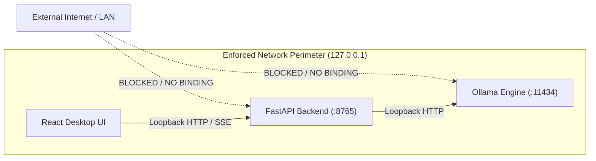

# Security & Confidentiality Design

## 1. Threat Model & Security Posture

NEXUS is engineered as a zero-trust, local-first application. It assumes the local machine may run alongside untrusted software or have limited hardware protection.



---

## 2. Hard Security Enforcements

### 2.1 Loopback Isolation
- The FastAPI backend binds exclusively to `127.0.0.1:8765`.
- The Ollama connection in `OllamaAIProvider` enforces `127.0.0.1` at the class constructor level:
  ```python
  if "127.0.0.1" not in base_url and "localhost" not in base_url:
      raise ValueError(f"Security violation: Ollama endpoint must be localhost (127.0.0.1), got {base_url}")
  ```
- No LAN exposure (`0.0.0.0`) or remote URL acceptance is permitted.

### 2.2 Process Termination Guard
- `desktop/src/processManager.ts` maintains an internal `ownedPids: Set<number>`.
- Only the specific child PID spawned by NEXUS is killed during shutdown.
- NEXUS never executes broad wildcard termination commands (`taskkill /IM ollama*` or `taskkill /IM python*`).
- If process ownership cannot be verified, termination is skipped.

### 2.3 Zero-Logging Privacy Invariant
- Prompt contents, code snippets, project specifications, and generated responses are **never written to disk logs, terminal output, or telemetry streams**.
- Log outputs are restricted exclusively to system lifecycle events (e.g. `[AI Stream] Generation completed in 0.22s`).

### 2.4 Prompt Injection & Model Scope Restriction
- In Phase 2.3, inference is hard-restricted to `gemma3:1b`. Any incoming payload attempting to invoke an unverified model tag is rejected at the API boundary.
